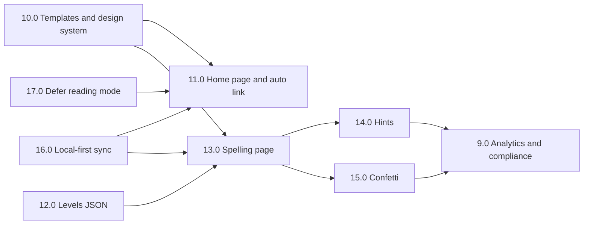

# Tasks: TapToSpell

Generated from `prd-taptospell.md`.

**Decisions folded in since the first PRD draft:**
- Images are generated with Gemini (Nano Banana), not sourced from stock libraries.
- Letter-bank distractors scale down as words get longer: 4 for 3–4 letter words, 3 for 5–6, 2 for 7+.
- Word data starts from the Dolch lists but is an extensible structure, categorised by grade and tagged easy / medium / hard.
- Two configurable sound sets, 1–5 files each, chosen at random per play.
- Mockups are generated and reviewed before any application code is written.

**Parent tasks were renumbered in this revision.** Mockups became 1.0 and audio became 7.0, shifting everything after them. If you have already started work against the previous numbering, the task content is unchanged — only the numbers moved.

**PRD revision 2 (2026-11-01) — decisions folded in:**
- Home page is built from `UI_TEMPLATES/home_page`; the spelling page from `UI_TEMPLATES/kids_spelling_word_game`. Their shared `DESIGN.md` replaces the revision 1 style sentence.
- Tapping a game on the home page creates the practice link automatically. The three-candidate slug choice screen is removed; the label moves to the parent view.
- Grade, points, level and progress are stored locally first and synced to D1 once per round, idempotently, so any device sees the same state.
- Version 1.0 is **spelling mode only**. Reading mode is kept but deferred to version 2.0 behind a disabled flag. "Writing mode" is renamed "spelling mode"; the DB value stays `'write'`.
- 5 spelling levels configured in `src/data/levels/spelling.json`.
- A correct answer fires canvas-confetti for 3 seconds, then auto-advances. The success sound plays once on word completion (this unblocks 7.12).
- Light-bulb hints: word length − 1 bulbs, each revealing one random letter.

**No renumbering in revision 2.** Completed tasks keep their numbers. Superseded sub-tasks are struck through with a pointer to their replacement, and new work is added as parent tasks 10.0–17.0.

---

## Relevant Files

| File | Purpose |
| --- | --- |
| `docs/mockups/*.png` | The seven generated screen mockups, reviewed before build |
| `docs/mockups/style-prompt.md` | The locked shared style sentence used for every mockup |
| `wrangler.jsonc` | Cloudflare Workers config: D1 binding, static assets, routes, cron trigger |
| `app.config.ts` | TanStack Start configuration, Workers deployment target |
| `migrations/0001_init.sql` | D1 schema: `links` and `progress` tables plus indexes |
| `src/data/words/schema.ts` | TypeScript type for a word entry; the contract every word list must satisfy |
| `src/data/words/grade-k.json` … `grade-3.json` | Word lists per grade, tagged with difficulty and picturability |
| `src/data/words/README.md` | How to add words to a list without breaking the pipeline |
| `scripts/generate-images.ts` | Calls Gemini to generate one image per picturable word using a fixed style prompt |
| `scripts/validate-words.ts` | Checks word entries against the schema; flags picturable words with no image |
| `scripts/validate-sounds.ts` | Checks each sound set holds 1–5 playable files of the expected format |
| `public/images/words/*.webp` | Generated word images, one per picturable word |
| `public/sounds/success/*.mp3` | Success sound set, 1–5 files |
| `public/sounds/retry/*.mp3` | Retry sound set, 1–5 files |
| `src/lib/slug.ts` | Slug generation from the unambiguous alphabet, collision checking |
| `src/lib/slug.test.ts` | Tests for `slug.ts` |
| `src/lib/words.ts` | Word selection: which 10 words a session draws, ordering, difficulty progression |
| `src/lib/words.test.ts` | Tests for `words.ts` |
| `src/lib/letter-bank.ts` | Builds the shuffled letter bank with scaled distractor count |
| `src/lib/letter-bank.test.ts` | Tests for `letter-bank.ts` |
| `src/lib/audio.ts` | Sound set discovery, preloading, no-repeat random selection, mute state |
| `src/lib/audio.test.ts` | Tests for `audio.ts`, including empty-set and load-failure paths |
| `src/lib/progress.ts` | Reads and batch-writes progress to D1 |
| `src/lib/progress.test.ts` | Tests for `progress.ts` |
| `src/lib/local-state.ts` | Guarded `localStorage` wrapper for mid-session state and mute preference |
| `src/lib/local-state.test.ts` | Tests for `local-state.ts`, including the throw path |
| `src/lib/rate-limit.ts` | Per-IP rate limiting for slug lookups |
| `src/routes/index.tsx` | Home page: grade picker, game cards, automatic link creation (rebuilt in 11.0) |
| `src/routes/$slug.tsx` | Practice page; reads `?parent` to switch to the parent view |
| `src/routes/api/links.ts` | POST creates and persists one link in a single call; GET resolves a slug with its full state; PATCH sets the label |
| `src/routes/api/progress.ts` | Superseded by `api/sync.ts` in 16.0 — remove once sync ships |
| `src/components/ReadingSession.tsx` | Reading mode UI — **version 2.0**, kept but unreachable in 1.0 |
| `src/components/WritingSession.tsx` | Renamed to `SpellingSession.tsx` in 13.1 |
| `src/components/AlphabetKeyboard.tsx` | Alphabetically ordered on-screen keyboard |
| `src/components/ProgressBar.tsx` | Child-facing bar — no numbers, no score |
| `src/components/MuteToggle.tsx` | Persistent mute control shown on every practice screen |
| `src/components/CelebrationScreen.tsx` | End-of-session screen with the two choices |
| `src/components/ParentView.tsx` | Parent progress view |
| `src/lib/analytics.ts` | The four events; no identifiers beyond the slug |
| `src/workers/expire-links.ts` | Daily cron job deleting links inactive for 12 months, and `rounds` rows older than 30 days |
| `public/privacy.html` | Privacy policy |
| `docs/data-retention-policy.md` | Written retention policy naming the 12-month period |
| **Added in revision 2** | |
| `UI_TEMPLATES/home_page/*` | Design source for the home page (`code.html`, `DESIGN.md`, `screen.png`) |
| `UI_TEMPLATES/kids_spelling_word_game/*` | Design source for the spelling page |
| `tailwind.config.ts` | `DESIGN.md` tokens (colours, radii, spacing, type scale) compiled at build time — replaces the template's Tailwind CDN config |
| `public/fonts/*` | Self-hosted Rubik, Nunito Sans and Material Symbols subset — replaces Google Fonts |
| `public/images/ui/*` | Local mascot, logo and game-card images — replaces `lh3.googleusercontent.com` URLs |
| `migrations/0002_levels_points_sync.sql` | Adds `links.points`, `links.current_level`, `progress.hints_used`, the `rounds` table and its index |
| `src/data/levels/schema.ts` | TypeScript type for a level entry |
| `src/data/levels/spelling.json` | The 5 spelling levels |
| `src/data/levels/README.md` | How to edit levels without touching code |
| `scripts/validate-levels.ts` | Fails the build unless there are exactly 5 valid levels; warns on thin grade × level combinations |
| `src/lib/levels.ts` | Level lookup and progression (advance at round boundary, never down, cap at 5) |
| `src/lib/levels.test.ts` | Tests for `levels.ts` |
| `src/lib/hints.ts` | Pure hint logic: bulb count, random reveal position, tile bookkeeping |
| `src/lib/hints.test.ts` | Tests for `hints.ts` |
| `src/lib/confetti.ts` | Wrapper around `canvas-confetti`: 3-second burst, reduced-motion handling, cleanup |
| `src/lib/sync.ts` | Local-first sync: pending round queue, merge, retry/backoff, `sendBeacon` flush |
| `src/lib/sync.test.ts` | Tests for `sync.ts` |
| `src/lib/feature-flags.ts` | `READING_MODE_ENABLED = false` for version 1.0 |
| `src/routes/api/sync.ts` | POST accepts a round batch idempotently and returns the authoritative link state |
| `src/components/SpellingSession.tsx` | Spelling page built from the template (renamed from `WritingSession.tsx`) |
| `src/components/HintBulbs.tsx` | Light-bulb hint row |
| `src/components/LetterBoxes.tsx` | Answer boxes with child / pre-filled / hint / success states |
| `src/components/ShareBanner.tsx` | One-time share banner on the device that created the link |
| `src/components/GameCard.tsx` | Home-page game card (Spelling active, Reading "Coming in v2.0") |
| `src/components/BottomNav.tsx` | Home / Games / Parents navigation |
| `src/components/ParentsTab.tsx` | Links held on this device, plus "New link for another child" |
| `src/components/LinkHome.tsx` | Per-link home screen: progress bar, level, stars ("All done" destination)

### Notes

- Tests sit alongside the code they test: `slug.ts` and `slug.test.ts` in the same directory.
- This stack uses **Vitest with `@cloudflare/vitest-pool-workers`**, not Jest. It runs tests inside the real Workers runtime against a local D1 instance, which Jest cannot do. Run with `npx vitest` or `npx vitest src/lib/slug.test.ts` for a single file.
- Run `npx wrangler d1 migrations apply taptospell --local` before the first test run.
- Audio tests need a stubbed `HTMLAudioElement`; the Workers pool does not provide one. Keep `audio.ts` free of direct DOM calls so its selection logic can be tested without a browser.
- `scripts/` files are build-time tooling and are not deployed. They may use the Node APIs the Worker runtime lacks.

### Instructions for completing tasks

Mark each sub-task complete by changing `- [ ]` to `- [x]`. Update this file after each sub-task, not after each parent task.

---

## Tasks

- [x] **0.0 Create the feature branch**
  - [x] 0.1 Run `git checkout -b feature/taptospell`

- [x] **1.0 Generate and review UI mockups**
  - [x] 1.1 Save the shared style sentence from PRD section 6.1 to `docs/mockups/style-prompt.md` and treat it as locked for the whole set
  - [ ] ~~1.2 Generate Screen 1, Home / grade picker~~ — superseded by `UI_TEMPLATES/home_page` (10.0)
  - [ ] ~~1.3 Generate Screen 2, Slug choice and label~~ — screen removed in revision 2 (automatic link creation)
  - [ ] ~~1.4 Generate Screen 3, Reading session~~ — deferred with reading mode to version 2.0
  - [x] 1.5 Generate Screen 4, Writing session — superseded by `UI_TEMPLATES/kids_spelling_word_game`
  - [ ] ~~1.6 Generate Screen 5, Writing session incorrect tap~~ — superseded by the template plus PRD requirement 25
  - [ ] 1.7 Generate Screen 6, Celebration — now in `DESIGN.md` style (see 10.7)
  - [ ] 1.8 Generate Screen 7, Parent view — now in `DESIGN.md` style (see 10.7)
  - [x] 1.9 View all seven at actual phone width, not zoomed on a laptop, and check three things specifically: whether the letter bank crowds the image on Screen 4, whether tiles stay comfortably tappable, and whether the two celebration buttons genuinely read as equal rather than one looking like the default
  - [x] 1.10 Regenerate any screen that fails that review, then record which layout decisions the mockups changed so the build follows the reviewed version rather than the original description

- [x] **2.0 Scaffold the application, deployment pipeline, and database**
  - [x] 2.1 Initialise a TanStack Start project configured for the Cloudflare Workers deployment target
  - [x] 2.2 Configure `wrangler.jsonc` with the static assets binding, so asset requests stay free and unmetered
  - [x] 2.3 Create the D1 database and add its binding to `wrangler.jsonc`
  - [x] 2.4 Write `migrations/0001_init.sql` with the `links` and `progress` tables and the `idx_links_last_active` index, exactly as specified in the PRD
  - [x] 2.5 Apply the migration locally and confirm both tables exist
  - [x] 2.6 Install and configure Vitest with `@cloudflare/vitest-pool-workers`; add a trivial passing test to prove the harness runs against D1
  - [ ] 2.7 Deploy a hello-world page to Workers and confirm it serves
  - [ ] 2.8 Point the `taptospell.com` domain at the Worker and confirm TLS resolves

- [x] **3.0 Build the content pipeline for word lists and images**
  - [x] 3.1 Define the word entry type in `src/data/words/schema.ts`: `word`, `grade`, `difficulty` (`easy` | `medium` | `hard`), `picturable` (boolean), `frequencyRank`, `phoneticGroup`
  - [x] 3.2 Transcribe the Dolch lists into `grade-k.json` through `grade-3.json`, one file per grade, marking each word's `picturable` flag
  - [x] 3.3 Assign a difficulty tier to every word: easy for 2–3 letters, medium for 4–5, hard for 6+, then hand-adjust any word whose spelling is harder than its length suggests, such as "said" or "because"
  - [x] 3.4 Write `src/data/words/README.md` explaining how to append a word to a grade file and what each field means, so the lists can grow without reading the code
  - [x] 3.5 Write `scripts/validate-words.ts` to check every entry against the schema, flag duplicates across grades, and list picturable words with no generated image
  - [x] 3.6 Write `scripts/generate-images.ts` calling the Gemini image API with a single fixed style prompt reused for every word
  - [ ] 3.7 Lock the image style prompt before bulk generation — generate 10 sample words first, review them side by side, and only then run the full set
  - [x] 3.8 Generate images in batches with retry handling rather than one long loop, so a mid-run failure does not cost the whole run
  - [x] 3.9 Output all images as `.webp` at a single resolution into `public/images/words/`
  - [ ] 3.10 Review every generated image manually and regenerate any that are ambiguous, unsettling, or depict the wrong noun. This cannot be skipped — a wrong or odd picture in front of a 6-year-old is worse than a missing one
  - [x] 3.11 Add a CI step running `validate-words.ts` so a word added without an image fails the build

- [x] **4.0 Implement the practice link system**
  - [x] 4.1 Write `src/lib/slug.ts` generating 10-character slugs from `abcdefghjkmnpqrstuvwxyz23456789`
  - [x] 4.2 Add collision checking: query `links` and regenerate if the slug exists
  - [x] 4.3 Write tests covering alphabet correctness, length, and the collision-retry path
  - [x] 4.4 ~~Build `POST /api/links`: accepts a grade, returns three candidate slugs without persisting them~~ — replaced by 11.4
  - [x] 4.5 ~~Extend the endpoint to persist the chosen slug with its grade, optional label, and timestamps~~ — replaced by 11.4 and 11.9
  - [x] 4.6 Build `GET /api/links/:slug` resolving a slug to its grade and label
  - [x] 4.7 Write `src/lib/rate-limit.ts` capping slug lookups at 20 per minute per IP, returning 429 beyond that
  - [x] 4.8 Make the invalid-slug response identical for never-existed and expired slugs
  - [x] 4.9 ~~Build the home page per the reviewed Screen 1 mockup: grade picker and create button~~ — rebuilt from the template in 11.1
  - [x] 4.10 ~~Build the slug choice and label screen per the reviewed Screen 2 mockup~~ — screen removed in 11.4; label moves to the parent view (11.9)
  - [x] 4.11 Add a validation guard rejecting any attempt to supply a slug in the create request — slugs are server-generated only
  - [x] 4.12 Build `src/workers/expire-links.ts` deleting links and their progress rows after 12 months of inactivity; register it as a daily cron trigger
  - [x] 4.13 Write a test proving the expiry job deletes the right rows and leaves active links untouched

- [x] **5.0 Implement reading mode** — ⏸ **deferred to version 2.0.** Code and tests stay; hidden in 1.0 by 17.0
  - [x] 5.1 Write `src/lib/words.ts` selecting 10 words for a session: previously-missed words first, then unseen words, ordered by `frequencyRank` within `phoneticGroup`
  - [x] 5.2 Write tests for selection, covering a fresh link, a link with missed words, and a link that has seen every word in its grade
  - [x] 5.3 Build `ReadingSession.tsx` per the reviewed Screen 3 mockup, presenting one word at a time
  - [x] 5.4 Build `ProgressBar.tsx` as a fill-only bar with no numeric output of any kind
  - [x] 5.5 Wire the session to `$slug.tsx` so opening a link starts practice immediately — no splash, no start button, no interstitial
  - [x] 5.6 Hold mid-session state in `localStorage` via `local-state.ts` so a refresh does not lose the round
  - [x] 5.7 Verify the whole flow on a phone-width viewport before moving on

- [x] **6.0 Implement writing mode** (renamed spelling mode in revision 2; reworked in 13.0)
  - [x] 6.1 Write `src/lib/letter-bank.ts` building the bank from the answer's letters plus scaled distractors: 4 for 3–4 letter words, 3 for 5–6, 2 for 7+
  - [x] 6.2 Draw distractors from letters not in the answer, then shuffle the whole bank
  - [x] 6.3 Write tests for each length band, confirming the distractor count and that no distractor duplicates an answer letter
  - [x] 6.4 Build `AlphabetKeyboard.tsx` with tiles in alphabetical order, each at least 48×48 CSS pixels with 8px minimum spacing
  - [x] 6.5 ~~Build `WritingSession.tsx` per the reviewed Screen 4 mockup: image on top, one empty box per letter, bank beneath~~ — rebuilt from the template in 13.1
  - [x] 6.6 ~~Implement the correct-letter path: fill the next empty box, visually consume the tile~~ — replaced by free entry plus auto-check (13.2, 13.3)
  - [x] 6.7 ~~Implement the incorrect-letter path per the reviewed Screen 5 mockup: shake the tile, return it to the bank. No counter, no score change, no attempt limit~~ — replaced by the whole-word incorrect path (13.4)
  - [x] 6.8 ~~Implement difficulty progression — ascending word length first, then removal of the pre-filled first-letter hint~~ — replaced by JSON levels (12.0)
  - [x] 6.9 Restrict writing mode to words where `picturable` is true
  - [x] 6.10 Confirm no interface element anywhere in this mode communicates failure — no red X, no buzzer, no "Wrong"

- [x] **7.0 Implement the audio system**
  - [x] 7.1 Create `public/sounds/success/` and `public/sounds/retry/` and add the supplied files, 1–5 per set
  - [x] 7.2 Write `scripts/validate-sounds.ts` confirming each set holds between 1 and 5 files in a playable format, and wire it into CI
  - [x] 7.3 Write `src/lib/audio.ts` with a pure selection function: given a set and the last-played file, return a random file that is not the last one. Keep it free of direct DOM calls so it is testable without a browser
  - [x] 7.4 Write tests for selection covering a one-file set, which must return that file every time rather than failing the no-repeat rule, and a five-file set, which must never return the same file twice consecutively
  - [x] 7.5 Add set discovery so the code reads whatever files are present rather than hard-coding filenames, allowing sets to change without a code change
  - [x] 7.6 Preload both sets at session start so playback lands on the tap, not after it
  - [x] 7.7 Initialise the audio context on the child's first interaction, since mobile browsers block earlier auto-play
  - [x] 7.8 Make every failure path silent: an empty set, a missing file, a decode error, or a blocked context must let interaction continue with no error shown to the child
  - [x] 7.9 Write tests for the empty-set and load-failure paths, asserting the caller is unaffected
  - [x] 7.10 Build `MuteToggle.tsx` and place it on every practice screen, persisting the preference per device through `local-state.ts`
  - [x] 7.11 Wire the success set into reading mode on a correct answer (version 2.0 — inactive in 1.0)
  - [ ] 7.12 Wire the success set into spelling mode. **Unblocked by PRD revision 2:** play one sound on correct word completion, not per letter. Implemented as part of 15.3
  - [x] 7.13 Wire the retry set into both modes on an incorrect answer (spelling: now fires on an incorrect completed word, see 13.4)
  - [ ] 7.14 Listen to the retry set as a child would, several misses in a row on the same word. If it starts to feel like the app is enjoying the mistake, replace the file. Playful is the brief; mocking is out of scope

- [x] **8.0 Implement session completion, progress persistence, and the parent view**
  - [x] 8.1 Build `CelebrationScreen.tsx` per the reviewed Screen 6 mockup
  - [x] 8.2 Add the two options, equally weighted, neither pre-selected: "One more round" and "All done"
  - [x] 8.3 Wire "One more round" to start a fresh 10-item session in the same mode
  - [x] 8.4 Wire "All done" to a simple home screen showing the link's overall progress bar
  - [x] 8.5 Confirm nothing auto-starts a new session under any condition
  - [x] 8.6 ~~Write `src/lib/progress.ts` with a single batched upsert of all 10 results, called once at session end — never per word~~ — folded into local-first sync (16.0)
  - [x] 8.7 ~~Build `POST /api/progress` accepting the batch and updating `links.last_active`~~ — replaced by `POST /api/sync` (16.3)
  - [x] 8.8 Write a test asserting one completed session produces exactly one database round trip
  - [x] 8.9 Wrap every `localStorage` access in `local-state.ts` in try/catch and test the throw path explicitly — a private-browsing exception must not blank the screen
  - [x] 8.10 Build `ParentView.tsx` per the reviewed Screen 7 mockup, at `?parent`
  - [x] 8.11 Add a copy-link control to the parent view
  - [x] 8.12 Verify the parent view exposes nothing identifying beyond the parent's own label

- [ ] **9.0 Add analytics and compliance artifacts**
  - [ ] 9.1 Add Plausible or self-hosted Umami. Do not add Google Analytics
  - [ ] 9.2 Write `src/lib/analytics.ts` emitting exactly four events: `session_start` (grade, mode, level), `session_complete` (item count, elapsed seconds, level), `word_attempt` (correct/incorrect, mode, level, hints used), `parent_view_open`
  - [ ] 9.3 Audit every event payload to confirm it carries no name, label, IP, or identifier beyond the slug
  - [ ] 9.4 Write `public/privacy.html` stating plainly that no personal information is collected from children
  - [ ] 9.5 Write `docs/data-retention-policy.md` naming the 12-month inactivity period, as the amended COPPA Rule requires
  - [ ] 9.6 Grep the built bundle for third-party script tags and confirm none load — including the template's Tailwind CDN, Google Fonts and `lh3.googleusercontent.com` URLs (see 10.1–10.3)
  - [ ] 9.7 Confirm no field anywhere in the product accepts a child's name, age, birthday, school, or photo
  - [ ] 9.8 Verify Google's current terms permit commercial use of Gemini-generated images, and record the finding alongside the retention policy
  - [ ] 9.9 Confirm the audio files carry a licence permitting commercial use, or that they are your own work
  - [ ] 9.10 Record the `canvas-confetti` ISC licence alongside the other licence findings

- [ ] **10.0 Adopt the UI templates and design system** *(PRD 6.1, 4.10 req. 69)*
  - [ ] 10.1 Port the `DESIGN.md` tokens (colours, radii, spacing, font families, type scale) into `tailwind.config.ts`, compiled at build time. Do not ship the template's `cdn.tailwindcss.com` script
  - [ ] 10.2 Self-host Rubik, Nunito Sans and a Material Symbols subset (only the icons used) under `public/fonts/`; remove every `fonts.googleapis.com` / `fonts.gstatic.com` link
  - [ ] 10.3 Replace every `lh3.googleusercontent.com` image (mascot, logo, game-card thumbnail, sample cat) with a local asset in `public/images/ui/`, generated in the same Gemini style as the word images
  - [ ] 10.4 Strip out-of-scope template elements: the mascot volume button, "Letter of the Day" phonics panel, text-to-speech button, "Check answer" button, red error state and error banner, test-helper script hooks (`testWrongBtn`, `testRightBtn`, `hintAudioButton`), and the "Grades" nav tab
  - [ ] 10.5 Restyle the template's red "Reset" link in a neutral colour
  - [ ] 10.6 Extract shared pieces as components: push-button, pill badge, star counter, header, `BottomNav.tsx`
  - [ ] 10.7 Design Screen 6 (Celebration) and Screen 7 (Parent view) in the `DESIGN.md` style, following the PRD 6.1 descriptions
  - [ ] 10.8 Review both templates and the two new screens at actual phone width: does the hint-bulb row plus letter bank crowd the picture, are tiles and bulbs comfortably tappable, do the celebration buttons read as equal

- [ ] **11.0 Rebuild the home page with automatic link creation** *(PRD 4.1)*
  - [ ] 11.1 Rebuild `src/routes/index.tsx` from `UI_TEMPLATES/home_page`: header (star count, person icon), mascot card, five grade pills, game cards, bottom nav (Home, Games, Parents)
  - [ ] 11.2 Save the selected grade to device state in `local-state.ts`; pre-select the last grade on return, Kindergarten by default
  - [ ] 11.3 Build `GameCard.tsx`: Spelling with "Play Now"; Reading visibly disabled with a "Coming in v2.0" label and no tap handler
  - [ ] 11.4 Change `POST /api/links` to generate one slug, retry on collision, and persist it with its grade in a single call. Delete the three-candidate flow and the slug-choice screen. Keep the guard that rejects a client-supplied slug (4.11)
  - [ ] 11.5 Rate-limit link creation to 10 per hour per IP, returning 429
  - [ ] 11.6 "Play Now" reuses this device's existing link for the selected grade; otherwise creates one. Record new links in device state as `createdHere`
  - [ ] 11.7 Navigate to `/{slug}` straight after creation. Build `ShareBanner.tsx`: full URL, "Copy link", "Share" (Web Share API, falling back to copy). Show it once, only on the creating device, over the already-loaded game
  - [ ] 11.8 Build `ParentsTab.tsx`: list links held on this device (label, grade, stars, level), open each link's `?parent` view, and offer "New link for another child"
  - [ ] 11.9 Add `PATCH /api/links/:slug` to set or clear the label from the parent view. Confirm the label never reaches the URL
  - [ ] 11.10 Show the most recently used link's stars in the home header (0 if none); the person icon opens the Parents tab
  - [ ] 11.11 Update `links` API tests: single-call create, slug-supplied rejection, creation rate limit, label PATCH
  - [ ] 11.12 Time the flow on a phone: home page → "Play Now" → first word visible on the game page

- [ ] **12.0 Add the 5 spelling levels from JSON** *(PRD 4.3)*
  - [ ] 12.1 Define the level type in `src/data/levels/schema.ts` with the fields in PRD requirement 31
  - [ ] 12.2 Write `src/data/levels/spelling.json` with the five default levels from PRD requirement 32
  - [ ] 12.3 Write `scripts/validate-levels.ts`: fail unless there are exactly 5 levels with ids 1–5 that match the schema; warn for every grade × level with fewer picturable words than `questionsPerRound`. Add it to CI
  - [ ] 12.4 Extend `words.ts` to select a round by the current level's `wordLength` and `difficulty`, keeping missed-first ordering, with fallback to the nearest lengths and no repeats within a round
  - [ ] 12.5 Write `src/lib/levels.ts`: count mastered words per level, advance after `wordsToAdvance`, apply only at the next round, never go down, cap at 5
  - [ ] 12.6 Write `levels.test.ts` covering a fresh link, advancing exactly at the threshold, no mid-round change, the level 5 cap, and a JSON edit changing behaviour without a code change
  - [ ] 12.7 Drive `prefillFirstLetter`, `distractors`, `pointsPerWord` and `questionsPerRound` from the level config everywhere they are used; remove the hard-coded progression from 6.8
  - [ ] 12.8 Show the level badge ("Level N • {name}" with its `icon`) on the spelling page
  - [ ] 12.9 Write `src/data/levels/README.md` explaining each field and how to tune a level safely

- [ ] **13.0 Rebuild the spelling page from the template** *(PRD 4.2)*
  - [ ] 13.1 Rename `WritingSession.tsx` to `SpellingSession.tsx` and rebuild it from `UI_TEMPLATES/kids_spelling_word_game`: header, level badge, striped progress bar, "Word N of M" pill, prompt banner, picture card, hint row slot, `LetterBoxes.tsx`, letter grid with backspace and reset
  - [ ] 13.2 Implement free letter entry: a tile fills the next empty box, skipping pre-filled and hint-locked boxes, and is consumed; backspace removes the last child-placed letter and returns its tile; reset clears all child-placed letters only
  - [ ] 13.3 Check the answer automatically when the last empty box fills. No "Check answer" button
  - [ ] 13.4 Incorrect path: play a retry sound, shake the boxes gently, return only the incorrectly placed letters to the bank. No red, no "Oops" text, no counter, unlimited attempts
  - [ ] 13.5 Update `letter-bank.ts` to emit one tile per answer letter, duplicates included ("ball" → two `l` tiles), with stable tile ids; accept a per-level distractor override. Extend `letter-bank.test.ts`
  - [ ] 13.6 Header: back button goes to `LinkHome.tsx`, never the global home; star counter shows link points; the speaker button becomes `MuteToggle`
  - [ ] 13.7 Prompt banner copy: "Spell the N-letter word!" with no text-to-speech
  - [ ] 13.8 Show the "+N pts" badge on the picture card from the level's `pointsPerWord`
  - [ ] 13.9 Build `LinkHome.tsx` showing the link's overall progress bar, level and stars; make it the "All done" destination (update 8.4)
  - [ ] 13.10 Re-run the no-failure audit from 6.10 against the new page
  - [ ] 13.11 Verify on a phone-width viewport

- [ ] **14.0 Implement light-bulb hints** *(PRD 4.4)*
  - [ ] 14.1 Write `src/lib/hints.ts` as pure functions with an injectable random source: `bulbCount(word, prefill)` returns length − 1 with one pre-used when the first letter is pre-filled; `pickRevealIndex(state, rng)` chooses at random among boxes not yet correctly filled
  - [ ] 14.2 Handle tile bookkeeping on reveal: return a wrong child letter's tile to the bank, and consume the matching answer tile, picking the correct tile when letters repeat
  - [ ] 14.3 Write `hints.test.ts`: a 4-letter word gives 3 bulbs; pre-fill uses one; a reveal never targets a correct or locked box; repeated letters consume the right tile; a reveal that fills the last box triggers the auto-check
  - [ ] 14.4 Build `HintBulbs.tsx`: one light-bulb button per hint, at least 48×48 CSS pixels, with a used / off state; no sound, colour or message suggesting failure
  - [ ] 14.5 Show revealed letters in `LetterBoxes.tsx` in a distinct hint style, locked against backspace and reset
  - [ ] 14.6 Save used bulbs and revealed positions in mid-round local state so a refresh restores them
  - [ ] 14.7 Record hints used per word in per-link state; a word solved with any hint earns stars but is not marked mastered (PRD requirement 56 — confirm with PRD open question 8 first)
  - [ ] 14.8 Pass hints used into the `word_attempt` analytics payload (9.2)

- [ ] **15.0 Implement the correct-answer confetti celebration** *(PRD 4.5)*
  - [ ] 15.1 `npm install canvas-confetti` and `@types/canvas-confetti`; confirm it bundles and nothing loads from a CDN
  - [ ] 15.2 Write `src/lib/confetti.ts`: a 3-second burst loop with `disableForReducedMotion: true`, a canvas that ignores pointer events, and cleanup on unmount or navigation
  - [ ] 15.3 On a correct answer: success colour on the boxes, one success sound (closes 7.12), confetti for 3 seconds, stars animate into the header, then auto-advance to the next word
  - [ ] 15.4 Disable tile, hint and backspace input for the 3 seconds
  - [ ] 15.5 After the last word, go to the end-of-round screen once the confetti finishes; show stars earned this round and "New level!" when the level went up (update 8.1)
  - [ ] 15.6 Test the timing with fake timers: no advance before 3 s, exactly one advance after, and no double-advance from repeated taps
  - [ ] 15.7 Check the frame rate on a low-end tablet; reduce the particle count if it stutters

- [ ] **16.0 Implement local-first storage and cross-device sync** *(PRD 4.7, 4.8)*
  - [ ] 16.1 Extend `local-state.ts` with a versioned device store (recent links, last grade, mute, `createdHere`, share-banner shown) and a per-link store (grade, label, points, level, per-word stats, mid-round state, pending rounds)
  - [ ] 16.2 Write `migrations/0002_levels_points_sync.sql` per the PRD 7 schema; apply locally and in the test harness
  - [ ] 16.3 Build `POST /api/sync`: ignore a duplicate `round_id`; otherwise add points, upsert per-word results (sum attempts and hints, keep the earliest `mastered_at`), set the level to the higher of server and client, update `last_active`, and insert the `rounds` row — all in one D1 batch. Return the authoritative link state
  - [ ] 16.4 Extend `GET /api/links/:slug` to return the full link state (grade, label, points, level, progress summary)
  - [ ] 16.5 Write `src/lib/sync.ts`: queue rounds with a UUID `round_id`, sync once at round end, flush with `navigator.sendBeacon` on `pagehide` / `visibilitychange`, retry with backoff on the next open and on the `online` event, and merge the server response, re-applying pending rounds
  - [ ] 16.6 On opening a link, render from local state immediately and refresh from the server in the background; on a device with no local state, resolve the slug first
  - [ ] 16.7 Write `sync.test.ts` and API tests: a duplicate round is ignored; two devices' rounds both add points; an offline queue flushes once; a throwing `localStorage` falls back to memory and still syncs; one round equals one request
  - [ ] 16.8 Extend `expire-links.ts` to delete `rounds` older than 30 days and the rounds of expired links; extend its test
  - [ ] 16.9 Update `ParentView.tsx` to always fetch fresh server state and show label (editable via 11.9), grade, level, stars, mastered vs remaining, "Working on", "Needed hints", last practised, last synced, and Copy / Share
  - [ ] 16.10 Remove `api/progress.ts` and `progress.ts` once sync replaces them
  - [ ] 16.11 Manual cross-device check: play a round on a phone, open `?parent` on a laptop and confirm stars, level and words match; then play offline, reconnect, and confirm nothing is double-counted

- [ ] **17.0 Defer reading mode to version 2.0** *(PRD 4.12)*
  - [ ] 17.1 Add `src/lib/feature-flags.ts` with `READING_MODE_ENABLED = false`
  - [ ] 17.2 Remove reading mode from every route and from session-mode selection; `/{slug}` always starts spelling mode
  - [ ] 17.3 Keep `ReadingSession.tsx` and its tests compiling and passing, with a header comment marking them version 2.0
  - [ ] 17.4 Confirm analytics only emit `mode: 'write'` in version 1.0

---

## Notes on scope and sequencing

Task 1.0 blocks everything that renders a screen. The mockups exist to catch layout problems before code, so 4.9, 4.10, 5.3, 6.5, 6.7, 8.1 and 8.10 all build against the reviewed mockups rather than the written descriptions.

Tasks 2.0 through 4.0 must complete before 5.0, because reading mode depends on both the word pipeline and link routing. Task 6.0 depends on 3.0 for images. Task 7.0 depends on 5.0 and 6.0 existing, since it wires into both. Task 8.0 depends on 5.0 and 6.0. Task 9.0 can run in parallel with 8.0.

Sub-task 7.12 is no longer blocked: PRD revision 2 answered open question 6 (one success sound on word completion). It is implemented as part of 15.3.

Tasks 0.0 through 8.0 constitute the minimum launchable subset. Task 9.0 must also ship before public launch, because the compliance artifacts are not optional.

Audio adds roughly 4–6 hours to the 70-hour estimate, and the mockup pass adds 3–4. Launch remains achievable for January 4, 2027, but the buffer is now thinner.

### Revision 2 sequencing

Revision 2 changes what "launchable" means: **0.0–17.0 together, plus 9.0, are now the version 1.0 subset.** 5.0 (reading mode) stays in the codebase but does not ship.

- **10.0 comes first.** It blocks every screen in 11.0 and 13.0, the same way 1.0 did in revision 1.
- **12.0 and 16.0 have no UI dependency** and can start in parallel with 10.0. 16.2 (migration) must land before 16.3, and 16.1 before any UI task that reads per-link state.
- **13.0 needs 10.0 and 12.0**, because the page renders level config. 14.0 and 15.0 both need 13.0's letter boxes and can run in parallel with each other.
- **11.0 needs 16.1** for device state (last grade, recent links) and **17.0** so the Reading card is disabled from day one.
- **9.2 needs 12.0 and 14.0**, since `level` and `hints used` are now event fields.
- **Resolve PRD open questions 8, 9 and 10 before starting 13.0 and 14.7.** They change the star rule for hinted words, what numbers appear on the child screen, and the default round length.

**Effort.** A rough estimate of revision 2 is **26–34 hours**: templates 4–5, home page and auto-link 4–5, levels 3–4, spelling page 5–6, hints 3–4, confetti 1–2, sync 5–7, reading deferral under 1. Combined with the existing 70 + 7–10 hours, this puts the launch date at risk. Cut candidates, in order: the Games tab (Home already shows the same cards), the Parents tab list (the `?parent` URL still works), and the background cache refresh in 16.6 (fetch server state on open instead).
